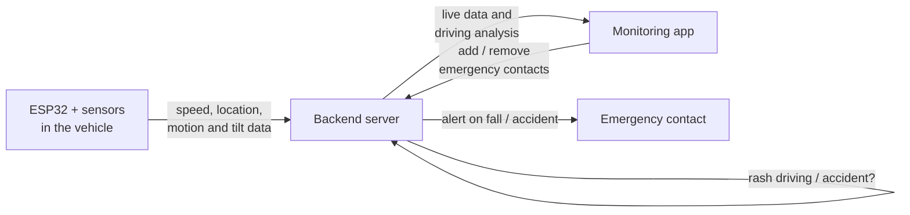

# Vehicle Safety Monitoring System 

An end-to-end system that monitors how a vehicle is driven, detects rash driving and falls or accidents,
and automatically alerts an emergency contact. It has three parts: an **ESP32 device** in the vehicle,
a **backend** that analyses the incoming data, and a **mobile app** for monitoring.

## What it does

- Reads the vehicle's **speed, location, tilt and motion** in real time
- Decides whether the driving is **normal, rash, or an accident / fall**
- **Alerts the emergency contact** when a fall or accident is detected
- Shows live speed and location in the app
- Gives an **overall driving-behaviour analysis** of how the driver drove (per day and per month)
- Lets the user manage emergency contacts from the app

## How it works

1. The **ESP32** collects sensor data and sends it to the backend over the network.
2. The **backend** receives the data, decides whether the driving is rash or whether an accident has happened,
   and stores the results.
3. If a fall or accident is detected, the backend **alerts the emergency contact** that was added in the app.
4. The **app** shows live speed and location and the driving-behaviour analysis.

The decision limits were set by **testing and observing real driving situations**.

## Hardware

| Component | Purpose |
|---|---|
| ESP32 | Microcontroller with Wi-Fi: reads the sensors and sends the data to the backend |
| GPS module | Location and speed |
| IMU (accelerometer + gyroscope) | Motion and tilt of the vehicle |
| Ultrasonic sensor | <what it measures in this project> |
| <other sensors / power / enclosure> | <purpose> |

## The monitoring app

- Live **speed** and **location** of the vehicle
- **Driving analysis**: how much of the drive was normal vs. rash, by day and month, plus average speed
- **Emergency contacts**: add, view and remove the people who are alerted after an accident

## Backend overview

Built with Python and FastAPI. It:

- accepts sensor readings from the ESP32 and decides whether each one is normal driving, rash driving or an accident
- stores readings and locations in a database
- streams live speed and location to the app (WebSocket)
- keeps the emergency contact list
- computes the daily and monthly driving statistics shown in the app

## Authors

Jerin Paul
Salvi Hanna John
Adithiyan P
Hashim Sharaf
